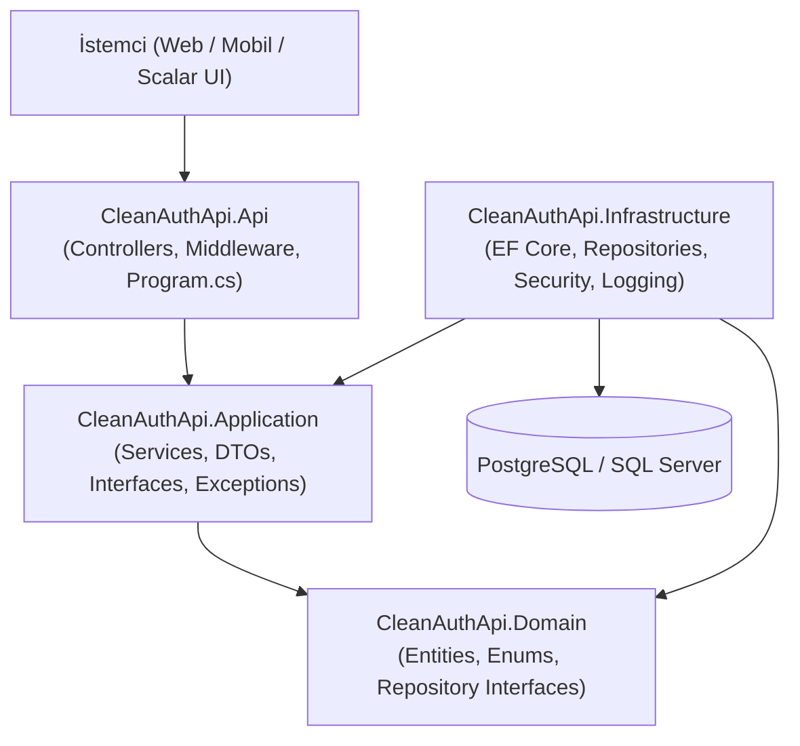

# CleanAuthApi — .NET 10 Clean Architecture RESTful API


**CleanAuthApi**, **.NET 10** kullanılarak **Clean Architecture (Katmanlı Mimari)** prensiplerine uygun olarak geliştirilmiş; **JWT Kimlik Doğrulama (Access & Refresh Token Rotasyonu)**, **Rol Bazlı Yetkilendirme (RBAC)** ve **Kapsamlı Güvenlik / Denetim Loglama (Security & Audit Logging)** özelliklerine sahip modern bir RESTful API sunucusudur.

---

## Öne Çıkan Özellikler

- **Clean Architecture (4 Katmanlı Yapı):** `Domain`, `Application`, `Infrastructure` ve `Api` katmanlarıyla gevşek bağlı (loosely coupled), test edilebilir ve sürdürülebilir mimari.
- **Güçlü Kimlik Doğrulama & Güvenlik:**
  - **HMAC-SHA256** imzalı JWT Access Token üretimi.
  - **Tek Kullanımlık Refresh Token Rotasyonu** (Replay Attack koruması) ve oturum sonlandırma (`Revoke`).
  - **PBKDF2-SHA256** (100.000 iterasyon + kriptografik rastgele `Salt` + `FixedTimeEquals` Timing Attack koruması) ile güvenli şifre özetleme.
  - **Rol Bazlı Yetkilendirme:** `User` ve `Admin` rolleriyle korunan uç noktalar.
- **Çoklu Veritabanı Desteği (EF Core 10):** `appsettings.json` üzerinden tek satırla **PostgreSQL** veya **SQL Server** seçimi ve başlangıçta otomatik tablo/indeks ilklendirme (`DbInitializer`).
- **Ayrı Tablolarda Güvenlik ve Denetim Loglama:**
  - `DatabaseErrorLogs`: Veritabanı ve sistem hataları (`SqlState`, `StackTrace`, kaynak işlem, IP).
  - `FailedLoginLogs`: Hatalı şifre, kayıtlı olmayan e-posta, pasif hesap ve geçersiz refresh token denemeleri.
  - `PasswordChangeLogs`: Başarılı ve başarısız şifre değiştirme denemeleri.
  - `SecurityAuditLogs`: Kayıt, başarılı giriş, token yenileme, oturum kapatma, profil güncelleme ve hesap silme denetim kayıtları.
- **Merkezi Hata Yönetimi:** `GlobalExceptionMiddleware` ile standartlaştırılmış `ApiResponse<T>` JSON yanıt yapısı.
- **İnteraktif API Dokümantasyonu:** **OpenAPI** ve **Scalar UI** (`/scalar/v1`) entegrasyonu.
- **Otomatik Güvenlik ve Entegrasyon Testleri:** `xUnit` ve `WebApplicationFactory` ile uçtan uca test senaryoları.

---

## Mimari Yapı



### Proje Dizin Yapısı

```text
CleanAuthApi/
├── database/
│   └── postgresql_init.sql                # PostgreSQL tablo ve indeks oluşturma betiği (DDL)
├── src/
│   ├── CleanAuthApi.Domain/               # Çekirdek varlıklar (Entities), Enum'lar ve Arayüzler
│   ├── CleanAuthApi.Application/          # İş mantığı servisleri, DTO'lar ve Validasyonlar
│   ├── CleanAuthApi.Infrastructure/       # EF Core DbContext, Repository'ler, JWT, Hasher ve Güvenlik Loglama
│   └── CleanAuthApi.Api/                  # REST Controller'lar, Middleware, DI ve Konfigürasyon
├── tests/
│   └── CleanAuthApi.Tests/                # xUnit Birim ve Entegrasyon / Güvenlik Testleri
└── CleanAuthApi.slnx                      # .NET 10 Çözüm Dosyası
```

---

## API Uç Noktaları (Endpoints)

### 1. Kimlik Doğrulama (`AuthController`)
| Metot | Endpoint | Yetki | Açıklama |
| :--- | :--- | :--- | :--- |
| `POST` | `/api/auth/register` | Açık | Yeni kullanıcı kaydı oluşturur, Access & Refresh Token döner |
| `POST` | `/api/auth/login` | Açık | E-posta ve şifre ile giriş yapar, Access & Refresh Token döner |
| `POST` | `/api/auth/refresh` | Açık | Refresh token ile yeni Access & Refresh Token çifti üretir |
| `POST` | `/api/auth/revoke` | `[Authorize]` | Kullanıcının mevcut Refresh Token'ını iptal eder (Oturumu kapatır) |

### 2. Kullanıcı İşlemleri (`UsersController`)
| Metot | Endpoint | Yetki | Açıklama |
| :--- | :--- | :--- | :--- |
| `GET` | `/api/users/me` | `[Authorize]` | Giriş yapmış kullanıcının profil bilgilerini döner |
| `PUT` | `/api/users/me` | `[Authorize]` | Giriş yapmış kullanıcının ad ve soyad bilgilerini günceller |
| `PUT` | `/api/users/me/password` | `[Authorize]` | Kullanıcının mevcut şifresini doğrulayarak şifresini değiştirir |
| `GET` | `/api/users` | `[Authorize(Roles = "Admin")]` | Sistemdeki tüm kullanıcıları listeler |
| `DELETE` | `/api/users/{id}` | `[Authorize(Roles = "Admin")]` | Belirtilen kullanıcıyı siler |

### 3. Güvenlik Logları (`SecurityLogsController`)
| Metot | Endpoint | Yetki | Açıklama |
| :--- | :--- | :--- | :--- |
| `GET` | `/api/securitylogs/failed-logins` | `[Authorize]` | Son başarısız giriş / yanlış şifre denemelerini listeler |
| `GET` | `/api/securitylogs/password-changes` | `[Authorize]` | Başarılı ve başarısız şifre değiştirme kayıtlarını listeler |
| `GET` | `/api/securitylogs/database-errors` | `[Authorize]` | Veritabanı ve sistem hata kayıtlarını listeler |
| `GET` | `/api/securitylogs/audit-logs` | `[Authorize]` | Genel güvenlik denetim kayıtlarını listeler |

---

## Veritabanı Tabloları

Uygulama toplam **5 ayrı tablo** kullanır:
1. **`Users`**: Kullanıcı kimlik, rol ve oturum (`RefreshToken`) bilgileri.
2. **`DatabaseErrorLogs`**: Veritabanı ve sistem hatalarının (`ErrorType`, `ErrorCode`, `Message`, `StackTrace`, `SourceOperation`, `IpAddress`) tutulduğu tablo.
3. **`FailedLoginLogs`**: Yanlış şifre, geçersiz e-posta veya geçersiz token denemelerinin (`Email`, `UserId`, `FailureReason`, `IpAddress`, `UserAgent`) tutulduğu tablo.
4. **`PasswordChangeLogs`**: Şifre değiştirme işlemlerinin başarı durumu ve hata nedenlerinin (`UserId`, `Email`, `IsSuccess`, `FailureReason`) tutulduğu tablo.
5. **`SecurityAuditLogs`**: Kayıt, giriş, token yenileme, oturum sonlandırma ve profil işlemlerinin tutulduğu denetim tablosu.

> PostgreSQL için hazır DDL betiği [`database/postgresql_init.sql`](database/postgresql_init.sql) dosyasında yer almaktadır. Ayrıca uygulama ilk kez çalıştığında tablolar mevcut değilse otomatik olarak oluşturulur.

---

## Kurulum ve Çalıştırma

### Gereksinimler
- [.NET 10 SDK](https://dotnet.microsoft.com/download)
- PostgreSQL veya SQL Server

### 1. Projeyi Klonlayın
```bash
git clone https://github.com/KULLANICI_ADINIZ/CleanAuthApi.git
cd CleanAuthApi
```

### 2. Veritabanı ve JWT Ayarlarını Yapılandırın
`src/CleanAuthApi.Api/appsettings.json` dosyasını kendi ortamınıza göre düzenleyin:

```json
{
  "DatabaseProvider": "PostgreSQL",
  "ConnectionStrings": {
    "SqlServer": "Server=(localdb)\\mssqllocaldb;Database=CleanAuthApiDb;Trusted_Connection=True;TrustServerCertificate=True",
    "PostgreSQL": "Host=localhost;Port=5432;Database=clean_auth_api_db;Username=postgres;Password=YOUR_PASSWORD"
  },
  "JwtSettings": {
    "SecretKey": "SuperSecretKey_CleanAuthApi_ChangeInProduction_2026!@#",
    "Issuer": "CleanAuthApi",
    "Audience": "CleanAuthApiClient",
    "ExpiryMinutes": 60
  }
}
```

### 3. Uygulamayı Çalıştırın
```bash
dotnet run --project src/CleanAuthApi.Api
```

Uygulama çalıştığında interaktif API dokümantasyonuna tarayıcınızdan ulaşabilirsiniz:
- **Scalar API UI:** `http://localhost:5150/scalar/v1`
- **OpenAPI JSON:** `http://localhost:5150/openapi/v1.json`

---

## Testleri Çalıştırma

Projedeki birim (Unit) ve uçtan uca güvenlik/entegrasyon (Integration) testlerini çalıştırmak için:

```bash
dotnet test
```

### Doğrulanan Test Senaryoları
- PBKDF2-SHA256 şifre özetleme ve benzersiz Salt üretimi (Rainbow Table koruması)
- Tokensız veya sahte (forged) JWT ile korumalı uç noktalara erişim engeli (`401 Unauthorized`)
- Standart kullanıcının Admin uç noktalarına erişim engeli (`403 Forbidden`)
- Refresh Token rotasyonu ve eski token ile tekrar giriş engeli (Replay Attack koruması)
- Başarısız girişlerin `FailedLoginLogs`, şifre değişimlerinin `PasswordChangeLogs` ve güvenlik olaylarının `SecurityAuditLogs` tablolarına kaydedilmesi

---

## Lisans

Bu proje MIT Lisansı altında lisanslanmıştır.
